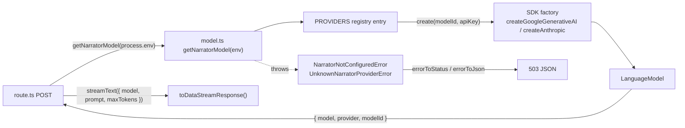

# Design Document

## Overview

The narrator route currently imports `@ai-sdk/anthropic` and hard-codes `ANTHROPIC_API_KEY` and `claude-haiku-5-5`. This design moves model selection into one module, `lib/narrator/model.ts`, which holds a provider registry and exports `getNarratorModel(env)`. The route calls that function and passes the result to `streamText`. Google Gemini is the default provider. Anthropic stays registered. Adding a provider is one registry entry plus its SDK package.

Language: TypeScript (strict), Vercel AI SDK `ai` 4.3.x (installed 4.3.19), Vitest.

Unchanged: `build-prompt.ts`, `schema.ts`, `rate-limit.ts`, `NarratorPanel.tsx`, request check order, `toDataStreamResponse()` output.

## Architecture

`lib/narrator/model.ts` is the only module that imports a provider SDK. The route imports only `ai`, `getNarratorModel`, and the error helpers.



Request order in the route stays the same as today, with the config check now provided by `getNarratorModel`:

1. `getNarratorModel(process.env)`; on a typed config error, return 503.
2. Rate limit (429).
3. Parse JSON (400) and `narrateBodySchema` (400).
4. `buildNarratorPrompt`, `streamText`, `toDataStreamResponse()`.

## Components and Interfaces

### `lib/narrator/model.ts` (new)

```ts
import type { LanguageModel } from "ai";
import { createGoogleGenerativeAI } from "@ai-sdk/google";
import { createAnthropic } from "@ai-sdk/anthropic";
import { NarratorNotConfiguredError, UnknownNarratorProviderError } from "@/lib/errors";

export type Env = Record<string, string | undefined>;

export interface ProviderEntry {
  defaultModel: string;
  apiKeyEnv: string;
  create: (modelId: string, apiKey: string) => LanguageModel;
}

export const DEFAULT_PROVIDER = "google";

export const PROVIDERS: Record<string, ProviderEntry> = {
  google: {
    defaultModel: "gemini-4-hydrogen",
    apiKeyEnv: "GOOGLE_GENERATIVE_AI_API_KEY",
    create: (modelId, apiKey) => createGoogleGenerativeAI({ apiKey })(modelId),
  },
  anthropic: {
    defaultModel: "claude-haiku-5-5",
    apiKeyEnv: "ANTHROPIC_API_KEY",
    create: (modelId, apiKey) => createAnthropic({ apiKey })(modelId),
  },
};

export interface NarratorModel {
  model: LanguageModel;
  provider: string;
  modelId: string;
}

export function getNarratorModel(
  env: Env,
  registry: Record<string, ProviderEntry> = PROVIDERS
): NarratorModel {
  const provider = (env.NARRATOR_PROVIDER ?? "").trim().toLowerCase() || DEFAULT_PROVIDER;
  const entry = Object.hasOwn(registry, provider) ? registry[provider] : undefined;
  if (!entry) {
    throw new UnknownNarratorProviderError(provider, Object.keys(registry));
  }
  const apiKey = env[entry.apiKeyEnv];
  if (!apiKey || apiKey.trim() === "") {
    throw new NarratorNotConfiguredError(provider, entry.apiKeyEnv);
  }
  const modelId = (env.NARRATOR_MODEL ?? "").trim() || entry.defaultModel;
  return { model: entry.create(modelId, apiKey), provider, modelId };
}
```

Notes:

- The return type is `{ model, provider, modelId }` rather than a bare `LanguageModel`. Requirements 1.1 says "returns a Narrator_Model"; the wrapper still contains the `LanguageModel`. The extra fields let tests assert provider and model ID (Requirement 7.2 to 7.4) without reaching into SDK internals. Requirement 1.1 wording can stay as is; treat `NarratorModel.model` as the Narrator_Model.
- `registry` is an optional second parameter defaulting to `PROVIDERS`. It lets tests inject a stub entry (Requirement 1.7) and capture the `apiKey` passed to `create`. The route never passes it.
- `Object.hasOwn` prevents names like `constructor` or `__proto__` from matching inherited properties.
- `.trim() === ""` treats a whitespace-only key as missing.

### Passing the API key explicitly

AI SDK providers read their key from `process.env` by default (`anthropic` and `google` default instances). Using those would make `env` a second source of truth and would break the "reads no `process.env`" rule (Requirement 1.2) in tests. Each `create` instead builds a provider instance with the key from `env`:

| Provider | Factory | Verified |
| --- | --- | --- |
| anthropic | `createAnthropic({ apiKey })` | Yes. Installed `@ai-sdk/anthropic` 1.2.12 exports `createAnthropic` and `AnthropicProviderSettings`. |
| google | `createGoogleGenerativeAI({ apiKey })` | **Confirm after install.** `@ai-sdk/google` is not yet in `node_modules`. This is the documented factory name for the 1.x line. Run `npm install @ai-sdk/google@^1` and check `dist/index.d.ts` exports it. |

The returned provider is called with the model ID: `createGoogleGenerativeAI({ apiKey })(modelId)`. The result must be assignable to `LanguageModel` from `ai` 4.x (`LanguageModelV1`). If type mismatch appears after install, check that `@ai-sdk/google` 1.x is the line paired with `ai` 4.x.

### Resolution algorithm (exact order)

1. Provider name: `(env.NARRATOR_PROVIDER ?? "").trim().toLowerCase()`; empty becomes `google`.
2. Registry lookup. Not found: throw `UnknownNarratorProviderError(name, supportedNames)`.
3. API key: `env[entry.apiKeyEnv]`. Missing, empty, or whitespace: throw `NarratorNotConfiguredError(provider, entry.apiKeyEnv)`. No fallback to another provider.
4. Model ID: trimmed `env.NARRATOR_MODEL`, or `entry.defaultModel` when empty.
5. Call `entry.create(modelId, apiKey)` and return `{ model, provider, modelId }`.

Provider lookup precedes key lookup, so an unknown provider is reported even when no key is set.

### Adding a provider (worked example: OpenAI)

1. Install the SDK: `npm install @ai-sdk/openai@^1`.
2. Add one entry in `PROVIDERS` in `lib/narrator/model.ts`:
   ```ts
   import { createOpenAI } from "@ai-sdk/openai";
   // ...
   openai: {
     defaultModel: "gpt-4o-mini",
     apiKeyEnv: "OPENAI_API_KEY",
     create: (modelId, apiKey) => createOpenAI({ apiKey })(modelId),
   },
   ```
3. Document `OPENAI_API_KEY` and the new default in `.env.local.example`.

No change to the route, errors, or `NarratorPanel`. The supported-provider list in error messages updates itself from the registry keys.

### `lib/errors.ts` (modified)

Match the existing pattern exactly: `readonly code` string literal, constructor builds the message, sets `this.name`.

```ts
export class NarratorNotConfiguredError extends Error {
  readonly code = "NARRATOR_NOT_CONFIGURED";
  constructor(provider: string, envVar: string) {
    super(`Narrator is offline: ${envVar} is not configured for provider "${provider}".`);
    this.name = "NarratorNotConfiguredError";
  }
}

export class UnknownNarratorProviderError extends Error {
  readonly code = "UNKNOWN_NARRATOR_PROVIDER";
  constructor(provider: string, supported: string[]) {
    super(`Unknown narrator provider: "${provider}". Supported providers: ${supported.join(", ")}.`);
    this.name = "UnknownNarratorProviderError";
  }
}
```

Mapping changes:

- `errorToStatus`: add `if (err instanceof NarratorNotConfiguredError) return 503;` and the same for `UnknownNarratorProviderError`.
- `errorToJson`: add both classes to the existing `instanceof` union so the result is `{ error: err.message, code: err.code }`.

The unknown provider value is user-supplied configuration, not a secret. A misconfigured `NARRATOR_PROVIDER` that someone pasted a key into would be echoed in the message. To limit that, the constructor truncates the echoed name to 50 characters in the message. (Requirement 3.4 forbids API key values in the message; truncation is a mitigation for that edge case, not a guarantee.)

### `app/api/narrate/route.ts` (modified)

```ts
import { streamText } from "ai";
import { getNarratorModel } from "@/lib/narrator/model";
import { errorToJson, errorToStatus, NarratorNotConfiguredError, UnknownNarratorProviderError } from "@/lib/errors";

/** Output budget. Gemini thinking tokens can count against this; value set after manual run (see Token budget). */
const NARRATOR_MAX_TOKENS = 400;

export async function POST(request: NextRequest) {
  let narrator;
  try {
    narrator = getNarratorModel(process.env);
  } catch (err) {
    if (err instanceof NarratorNotConfiguredError || err instanceof UnknownNarratorProviderError) {
      return new Response(JSON.stringify(errorToJson(err)), {
        status: errorToStatus(err),
        headers: { "Content-Type": "application/json" },
      });
    }
    throw err;
  }
  // rate limit, JSON parse, schema validation: unchanged
  const result = streamText({
    model: narrator.model,
    prompt,
    maxTokens: NARRATOR_MAX_TOKENS,
    temperature: 0.8,
  });
  return result.toDataStreamResponse();
}
```

The `@ai-sdk/anthropic` import and the `modelId` line are removed. The route never logs `process.env` or keys. `NarratorPanel` already shows the `error` field of a non-OK JSON response, so Requirement 4.7 needs no component change; confirm this when implementing by reading `NarratorPanel.tsx`.

## Token budget risk

Gemini thinking models spend hidden reasoning tokens that count toward the output limit. With `maxTokens: 400` the narration can be truncated or empty.

Manual verification (Requirement 6.1 to 6.3), recorded in the task completion notes:

1. Set `GOOGLE_GENERATIVE_AI_API_KEY`, leave `NARRATOR_PROVIDER` unset, run `npm run dev`.
2. Open a domain with a large diff, trigger the narrator, and check the narration is non-empty and ends on a full sentence. Repeat on 3 domains.
3. Repeat with `NARRATOR_PROVIDER=anthropic` to confirm Requirement 6.4.

Mitigations, pick based on the real run:

- **A. Raise the limit.** Change `NARRATOR_MAX_TOKENS` (for example to 1024). Simple, applies to both providers, costs more on Anthropic only when output is longer, and the prompt already asks for a short narration.
- **B. Lower the thinking budget.** Pass a Google-only provider option in `streamText`, for example `providerOptions: { google: { thinkingConfig: { thinkingBudget: 0 } } }`. The exact option name depends on the installed `@ai-sdk/google` 1.x version; confirm against its types after install. Other providers ignore the `google` key.

The chosen value and option are not fixed by this design. The real run decides. If B is used, keep the option keyed under `google` so it does not affect Anthropic.

## Data Models

No persisted data. Types: `Env`, `ProviderEntry`, `NarratorModel` (above). Configuration is read from these environment variables: `NARRATOR_PROVIDER`, `NARRATOR_MODEL`, `GOOGLE_GENERATIVE_AI_API_KEY`, `ANTHROPIC_API_KEY`.

## Error Handling

| Condition | Thrown by | Error | HTTP | JSON body |
| --- | --- | --- | --- | --- |
| `NARRATOR_PROVIDER` not in registry | `getNarratorModel` | `UnknownNarratorProviderError` | 503 | `{ error, code: "UNKNOWN_NARRATOR_PROVIDER" }` |
| Selected provider's key unset, empty, or blank | `getNarratorModel` | `NarratorNotConfiguredError` | 503 | `{ error, code: "NARRATOR_NOT_CONFIGURED" }` |
| Rate limit exceeded | route | none | 429 | `{ error }` (unchanged) |
| Invalid JSON body | route | none | 400 | `{ error }` (unchanged) |
| Body fails `narrateBodySchema` | route | none | 400 | `{ error, details }` (unchanged) |
| Provider call fails mid-request (bad key, quota) | AI SDK / `streamText` | SDK error | unchanged from today | unchanged |
| Any other error from `getNarratorModel` | `getNarratorModel` | rethrown | 500 via Next.js | none |

## Configuration and Documentation

### `.env.local.example` (full new contents)

```
# Copy this file to .env.local and fill in your values

# Narrator provider: google (default) or anthropic.
# Only the API key of the selected provider is required.
# NARRATOR_PROVIDER=google

# Required when NARRATOR_PROVIDER is google or unset (free tier available)
GOOGLE_GENERATIVE_AI_API_KEY=your_google_api_key_here

# Required only when NARRATOR_PROVIDER=anthropic
# ANTHROPIC_API_KEY=your_anthropic_api_key_here

# Optional: model ID override for the selected provider.
# Defaults: google = gemini-4-hydrogen, anthropic = claude-haiku-5-5
# NARRATOR_MODEL=gemini-4-hydrogen

# Optional: Base URL for the warm script (default: http://localhost:3000)
# WARM_BASE_URL=http://localhost:3000
```

### `.kiro/steering/tech.md` (AI narrator wording)

Stack bullet, replace:

> Vercel AI SDK for the narrator, streaming from a Claude model; API key from environment variables only

with:

> Vercel AI SDK for the narrator, streaming from Google Gemini by default; the provider is swappable through the provider registry in `lib/narrator/model.ts` (Anthropic is also registered); API keys from environment variables only

In "AI narrator", add a bullet:

> - Provider and model are chosen by `NARRATOR_PROVIDER` / `NARRATOR_MODEL`. Only `lib/narrator/model.ts` imports provider SDKs. Add a provider by adding one registry entry.

`.kiro/steering/structure.md` comment `narrator/  # prompt building` may become `# prompt building, model/provider registry`. Optional.

### `package.json`

Add `"@ai-sdk/google": "^1.2.0"` (1.x, compatible with `ai` 4.x) and refresh `package-lock.json` through `npm install`.

## Testing Strategy

Property tests use `fast-check` only if already acceptable to add; it is not in `package.json`. Without it, implement the properties below as table-driven Vitest cases over a fixed list of generated-style inputs (casings, whitespace, random strings from a seeded helper). Run at least 100 cases for the property-style tests if `fast-check` is added. Tag format: `Feature: narrator-llm-provider, Property N: ...`. Adding a dev dependency is a decision for the task phase; the design works either way.

Tests inject a plain object as `env`. Real SDK factories are acceptable in tests because they only construct a model object and make no network call; read `model.provider` / `model.modelId` from the returned model where the SDK exposes them, and use `NarratorModel.provider` / `.modelId` otherwise. Where the API key passed to `create` must be observed, inject a stub registry.

### `lib/narrator/model.test.ts` (new)

1. Defaults: empty env plus `GOOGLE_GENERATIVE_AI_API_KEY` returns provider `google`, model ID `gemini-4-hydrogen`.
2. `NARRATOR_PROVIDER=anthropic` plus `ANTHROPIC_API_KEY` returns provider `anthropic`, model ID `claude-haiku-5-5`.
3. `NARRATOR_PROVIDER=google` selects google.
4. Provider name is trimmed and case-insensitive (`"  Anthropic "`); blank `NARRATOR_PROVIDER` selects google.
5. Non-empty `NARRATOR_MODEL` overrides the default for each provider; blank or whitespace `NARRATOR_MODEL` uses the default.
6. Missing, empty, and whitespace-only key for each provider throws `NarratorNotConfiguredError` whose message contains the variable name (`GOOGLE_GENERATIVE_AI_API_KEY` or `ANTHROPIC_API_KEY`).
7. A key set for the other provider does not rescue a missing key for the selected one (no fallback).
8. Unknown provider (`"openai"`, `"constructor"`, random strings) throws `UnknownNarratorProviderError` whose message contains the value and both `google` and `anthropic`.
9. With a secret value such as `"sk-SECRET-123"` in the key variable (and in the wrong-provider case), no thrown message contains the secret.
10. Stub registry: an injected entry with a random name is selected by that name; the `create` stub receives `env[apiKeyEnv]` and the resolved model ID.
11. `getNarratorModel` ignores `process.env`: set a conflicting `process.env.NARRATOR_PROVIDER` and confirm the result follows the `env` argument.

### `lib/errors.test.ts` (additions)

- `NarratorNotConfiguredError` has `code` `NARRATOR_NOT_CONFIGURED`, `name` `NarratorNotConfiguredError`, message contains the env var name.
- `UnknownNarratorProviderError` has `code` `UNKNOWN_NARRATOR_PROVIDER`, `name`, message contains the value and supported names.
- `errorToStatus` returns 503 for both.
- `errorToJson` returns `{ error, code }` for both.

### Not tested at handler level

The route handler remains untested, per the existing deferral. Route behavior is covered by manual verification (Token budget section) and by `npm run test`, `npm run lint`, `npx tsc --noEmit`, `npm run build` (Requirement 8.3 to 8.6). The check that only `model.ts` imports provider SDKs is a code review step: `grep -rn "@ai-sdk/" app lib components` should list only `lib/narrator/model.ts` (and its test, if it imports an SDK).

## Security and Privacy

- API keys come only from the `env` argument, which the route fills from `process.env`. They are never logged, never placed in error messages, and never sent to the client. Error messages name the variable, not its value.
- `JSON.stringify(errorToJson(err))` contains only `error` and `code`.
- Google's free tier may use submitted content to improve Google products. The prompt contains only structured diff data (titles, headings, link text, short copy snippets) taken from public archived pages and capped by `schema.ts`. No user-identifying data is sent. Note this in `.env.local.example` or the README when the task phase edits docs; use a paid key if this is not acceptable.
- Request validation and rate limiting are unchanged.

## Correctness Properties

*A property is a characteristic or behavior that should hold true across all valid executions of a system-essentially, a formal statement about what the system should do. Properties serve as the bridge between human-readable specifications and machine-verifiable correctness guarantees.*

### Property 1: Resolution returns the selected provider or throws a typed error

For any env object, `getNarratorModel(env)` either returns a result whose `provider` equals the trimmed, lowercased `NARRATOR_PROVIDER` (or `google` when blank) and whose `modelId` equals the trimmed `NARRATOR_MODEL` (or that provider's default when blank), or throws exactly one of `UnknownNarratorProviderError` or `NarratorNotConfiguredError`. It never throws any other error type and never returns a different provider than the one selected.

**Validates: Requirements 1.1, 2.1, 2.2, 2.3, 2.4, 2.5, 2.7, 3.1, 3.2, 3.5**

### Property 2: Unknown provider names are rejected with the supported list

For any provider name not in the registry, `getNarratorModel` throws `UnknownNarratorProviderError` whose message contains that name and every registered provider name.

**Validates: Requirements 3.1**

### Property 3: Missing key names the variable

For any registered provider and any env where that provider's API-key variable is unset, empty, or whitespace, `getNarratorModel` throws `NarratorNotConfiguredError` whose message contains the exact variable name, regardless of other variables set in env.

**Validates: Requirements 2.6, 3.2, 3.5**

### Property 4: Error messages never contain key values

For any env object and any key value set in it, no message thrown by `getNarratorModel` contains that key value.

**Validates: Requirements 3.3, 3.4, 7.7, 8.1**

### Property 5: The API key comes from env, not process.env

For any env object and any conflicting `process.env` contents, `getNarratorModel(env)` passes `env[entry.apiKeyEnv]` to the entry's `create` and its result does not change when `process.env` changes.

**Validates: Requirements 1.2, 2.6**

### Property 6: A new registry entry is selectable without other changes

For any registry containing an additional entry with an arbitrary name, key variable, and default model, `getNarratorModel` with that name in `NARRATOR_PROVIDER` and the key set returns that entry's model using its default model ID, with no change to the route or errors modules.

**Validates: Requirements 1.3, 1.7**

### Property 7: Config errors map to 503 with a code

For any `NarratorNotConfiguredError` or `UnknownNarratorProviderError` instance, `errorToStatus` returns 503 and `errorToJson` returns an object with a string `error` equal to the message and a non-empty string `code`.

**Validates: Requirements 3.6, 3.7, 3.8**

Not property-tested: registry default values (examples in model tests), route order and streaming (manual and build checks), narration completeness (manual, Requirement 6), docs and dependency changes (review).

## Files Changed / Created

Created:

- `lib/narrator/model.ts`
- `lib/narrator/model.test.ts`
- `lib/narrator/error-message.ts` and `error-message.test.ts` (added during implementation: `useCompletion` sets `error.message` to the raw response body, so `NarratorPanel` uses `extractErrorMessage` to show the readable `error` field)

Modified:
- `components/NarratorPanel.tsx` (uses `extractErrorMessage`)

- `lib/errors.ts` (two error classes, `errorToStatus`, `errorToJson`)
- `lib/errors.test.ts` (new cases)
- `app/api/narrate/route.ts` (use `getNarratorModel`, `NARRATOR_MAX_TOKENS`, 503 handling)
- `.env.local.example`
- `.kiro/steering/tech.md`
- `.kiro/steering/structure.md` (optional comment tweak)
- `package.json`, `package-lock.json` (`@ai-sdk/google` ^1.x)

Not changed: `.kiro/specs/narrator-llm-provider/requirements.md`, `.config.kiro`, `phase-1-time-travel` spec, `build-prompt.ts`, `schema.ts`, `rate-limit.ts`, `NarratorPanel.tsx`.
